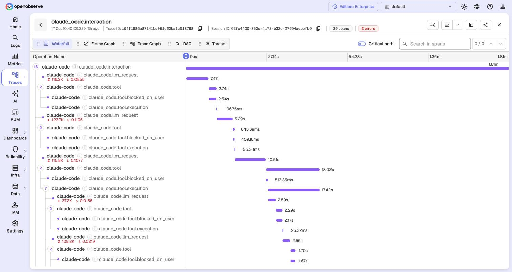
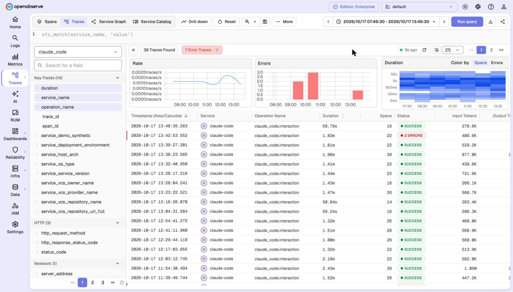
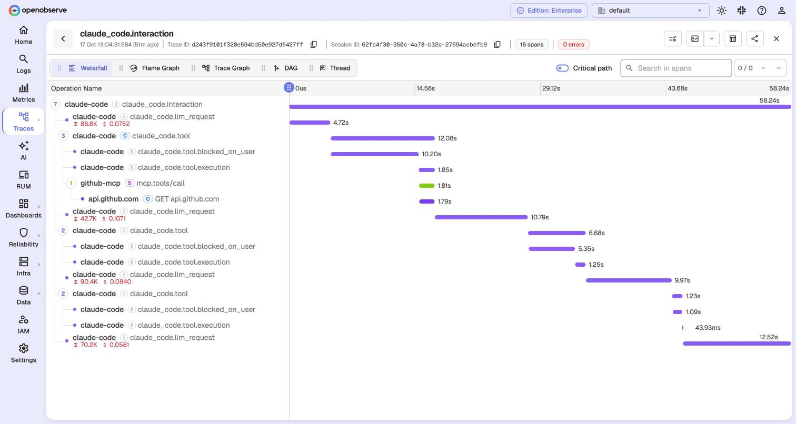
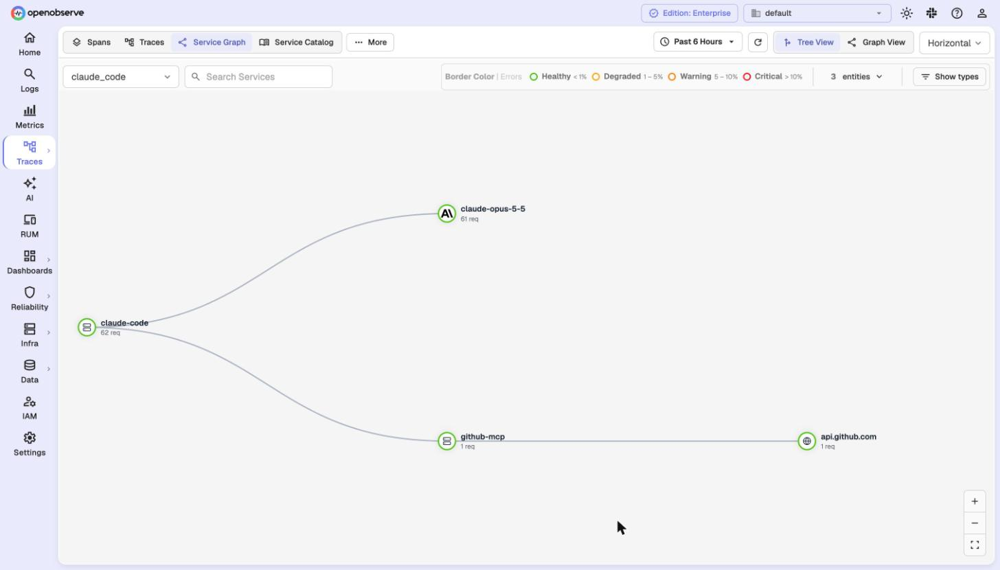
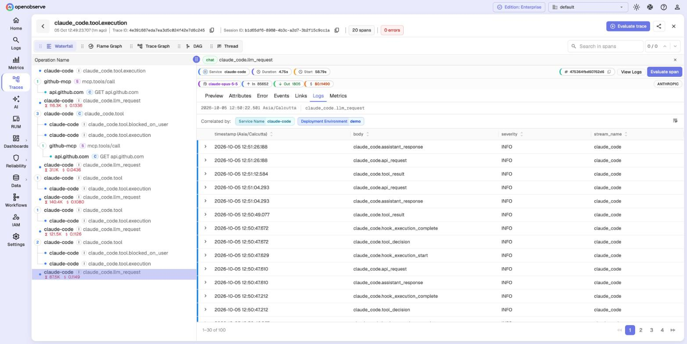

# openobserve-playground

[](https://github.com/Iamrushabhshahh/openobserve-playground/actions/workflows/ci.yml)
[](LICENSE)
[](https://openobserve.ai)

A ready-to-run [OpenObserve](https://openobserve.ai) on your laptop, set up for **tracing AI agents**.

Start it, load some example data, and click around. You'll see what an AI coding agent
actually does when you give it a task: every model call, every tool it runs, how long you kept
it waiting, and what it cost. When you're ready, connect your own Claude Code and watch your
real sessions.



## Try it in one command

You need **Docker** (with Compose v2), **make** and **Python 3**.

```bash
git clone https://github.com/Iamrushabhshahh/openobserve-playground.git
cd openobserve-playground
make quickstart
```

That's it. `make quickstart` checks your machine, creates `.env` with a generated password
(it prints the login), starts OpenObserve, loads 6 hours of example agent activity plus three
dashboards, and opens **<http://localhost:5080>**. Log in and go to **Traces**.

About two minutes on a first run, most of it pulling the 620 MB OpenObserve image once. After
that, a fresh start takes seconds.

Prefer the steps one by one? `make doctor`, `make up`, `make demo`, `make open`.

> The example data is made up. It looks exactly like real Claude Code data, so everything
> works the same way. Nothing leaves your machine.

## What to look at

**The traces list.** Each row is one task you gave the agent. You can see how long it took,
how many steps it had, and whether something failed.



**One trace.** Click a row. Each bar is one step: the agent thinking (a model call), running a
tool, or waiting for you to say "yes". Steps inside steps show a helper agent at work, or a
call that went out to another service.



**The service graph.** *Traces → Service Graph → Graph View.* A map of everything the agent
talked to: the AI models, the MCP server, and GitHub behind it.



**Logs next to traces.** Click any step, then the **Logs** tab. You get the log lines from that
moment, right beside the trace.



There's a full guided tour, with the queries behind each view, in
**[docs/tracing-tour.md](docs/tracing-tour.md)**.

## Use your own data

| I want to… | Do this |
|---|---|
| See my real Claude Code sessions | `make claude-code`, then start a new Claude Code session. [More →](claude-code/) |
| Stop sending them | `make claude-code-off` (your settings file is backed up first) |
| Send traces from my own app | Point any OpenTelemetry SDK at `http://localhost:5080/api/default`. [How →](docs/settings.md#send-your-own-data) |

`make claude-code` sends events, metrics and traces, but **not** your prompt text, tool inputs
or file contents. Add those only if you want them: `CONTENT=1 make claude-code`.

## Ask Claude about your data

[`mcp/`](mcp/) is an MCP server with 40 tools for investigating AI coding agents the way an
SRE investigates a service. Claude Code can answer questions like "where did the time go in my
slowest session?", "is the agent stuck in a loop?", "are we burning our error budget?", "when
will we hit our monthly budget?" or "what did the agent run in this session?" straight from
OpenObserve, without writing SQL. It covers the read paths of OpenObserve's built-in MCP
and adds what that one lacks.

```bash
make mcp-install      # Python 3.12+; installs it and registers it with Claude Code
```

The full tool list is in **[mcp/README.md](mcp/README.md)**.

## Everyday commands

```text
make quickstart  check, start, load example data, open the UI
make doctor      check Docker, the port, Python and .env
make up          start OpenObserve
make demo        load example data
make demo-live   keep adding new example tasks (Ctrl+C to stop)
make status      is it running? which version? how much data?
make down        stop (your data is kept)
make reset       delete everything and start fresh
make help        list every command
```

## What's in this folder

```text
docker-compose.yml   OpenObserve, ready for tracing (plus a tiny alert receiver)
Makefile             the commands above
.env.example         copy to .env and set your login
demo/                makes the example agent data
claude-code/         connect your real Claude Code, plus its dashboards and alerts
whoop/               optional extra: my WHOOP health data
scripts/             small helpers that `make` runs for you
docs/                tracing tour, settings explained, troubleshooting, screenshots
```

## Extras: my own projects on top

These are things I built on the playground for myself. You don't need any of them.

- **[WHOOP health data](whoop/)**: my recovery, HRV, sleep and strain as dashboards, with an
  alert when recovery drops. Needs a WHOOP band and a free WHOOP developer app.
- **[agent-obs MCP](mcp/)**: the SRE view of my coding agents (SLOs, regressions, budgets,
  audit trail), described above.

## Why I built this

I run Claude Code every day, and for months I couldn't tell you how many steps a prompt took,
what it cost, or how long it sat waiting for me. Any service in production gets that
visibility; my agent didn't. This repo is the smallest setup I could find that fixes that: one
container, a few environment variables, no collector in between. It turned up a number I
didn't want to see: 43 manual approvals cost me 2 hours 50 minutes in a month. The slow part
of my agent was me.

## Running it next to another OpenObserve

Set a different port and container name in `.env`, then `make up`:

```bash
O2_PORT=5090
O2_CONTAINER=openobserve-2
```

## Something not working?

Check **[docs/troubleshooting.md](docs/troubleshooting.md)**. The most common one: OpenObserve
won't start if your password is too simple. Use upper and lower case letters, a number and a
symbol.

Curious why each setting is there, or how to upgrade? See **[docs/settings.md](docs/settings.md)**.

## Contributing

Issues and pull requests are welcome. Start with [CONTRIBUTING.md](CONTRIBUTING.md); questions
go to [SUPPORT.md](SUPPORT.md), and security reports to [SECURITY.md](SECURITY.md). Everyone
follows the [Code of Conduct](CODE_OF_CONDUCT.md). Changes are listed in
[CHANGELOG.md](CHANGELOG.md).

---

MIT licensed. Not affiliated with OpenObserve, Anthropic or WHOOP. All screenshots use made-up data.
