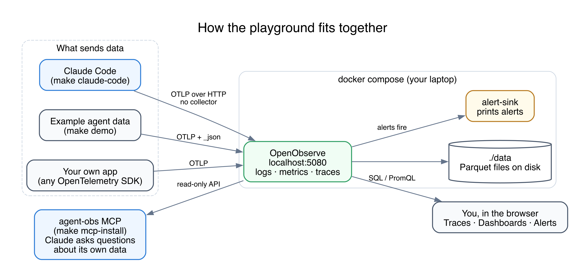
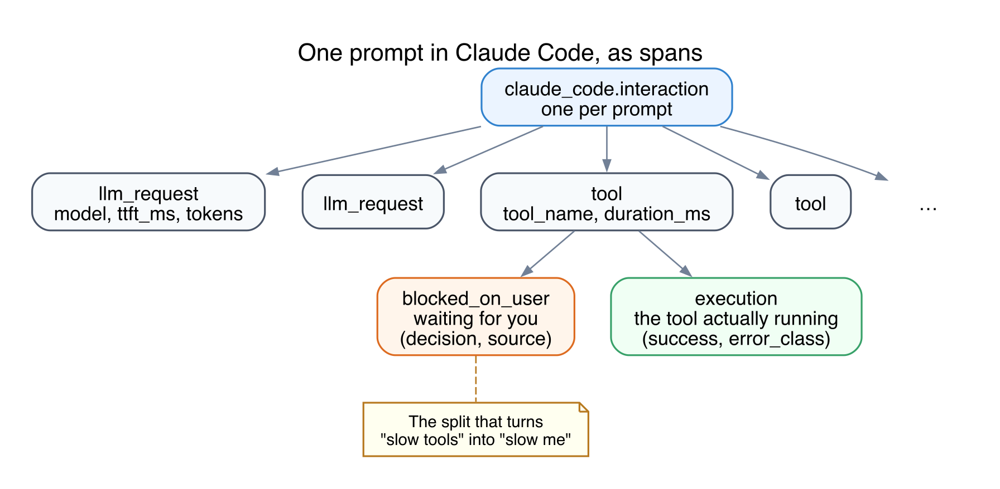
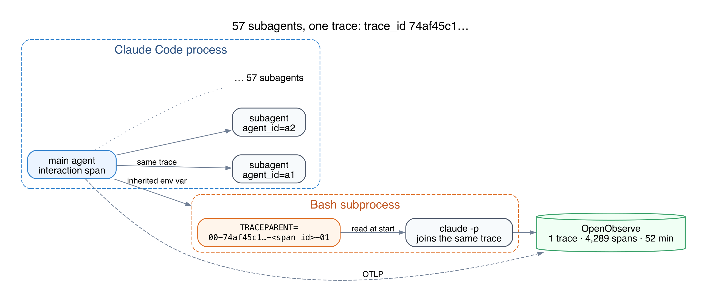
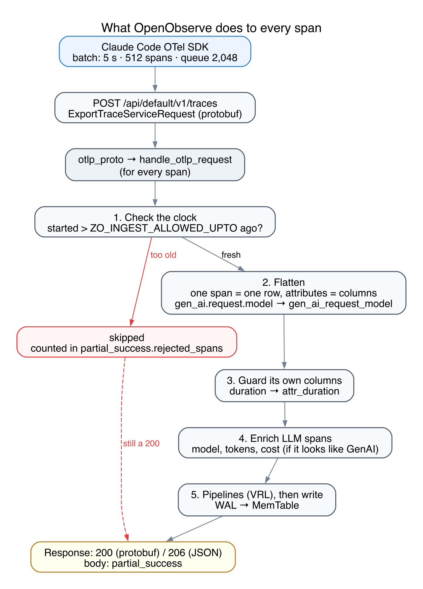
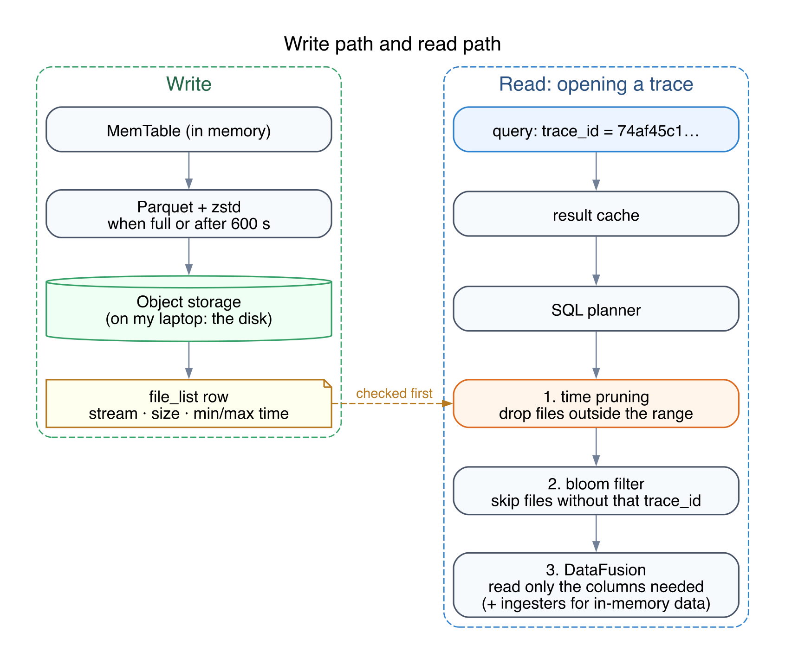

# How it works

You ran `make quickstart`, clicked a trace, and saw a waterfall. This page is what happened in
between: what sends the data, how it travels, what OpenObserve does with it, and why it's so
small on disk.

You don't need any of this to use the playground. It's for when you want to know what you're
looking at.

## The pieces

There is one container that matters: OpenObserve. It takes logs, metrics and traces on the same
port, stores them as files under `./data`, and serves the UI on <http://localhost:5080>.

Three things can send it data. Claude Code (after `make claude-code`), the example generator
(`make demo`), or your own app through any OpenTelemetry SDK. Claude Code talks to OpenObserve
directly over OTLP. There's no collector in between, because for one laptop you don't need one.

The small `alert-sink` container only prints alerts, so you can watch them fire with
`make alerts-log`. The agent-obs MCP server (`make mcp-install`) reads from OpenObserve's API so
Claude can answer questions about its own traces.

## One prompt, as spans

A **trace** is one task from start to finish. A **span** is one step inside it. Claude Code
turns each prompt into a small tree of spans.

The root, `claude_code.interaction`, is your prompt. Under it you get an `llm_request` for every
model call and a `tool` for every tool call.

Each tool call has two children, and that split is the most useful thing in the whole setup.
`blocked_on_user` is the time the agent sat waiting for you to approve something or answer a
question. `execution` is the tool actually running. Without that split you'd only know a tool was
slow. With it you know whether the tool was slow, or you were.

## Subagents stay in the same trace

When Claude Code starts a subagent, the subagent's spans land in the same trace, tagged with an
`agent_id`. When it runs a command that starts another `claude -p`, the trace ID is handed over
through an environment variable called `TRACEPARENT`, so that process joins the same trace too.

That's why my biggest prompt shows up as one trace with 57 subagents and 4,289 spans over 52
minutes, not 58 unrelated traces. You can do the same in your own scripts: read `TRACEPARENT`
and start your span from it.

## What OpenObserve does to every span

Spans are sent in batches, a few seconds apart. Each batch is one HTTP request to
`/api/default/v1/traces`. OpenObserve then works through every span in it:

Two things here catch people out.

**Old spans are dropped, and the request still succeeds.** A span that started more than 5 hours
ago is skipped by default (`ZO_INGEST_ALLOWED_UPTO`). The response is still a 200. The only sign
is a `partial_success` field in the body that most exporters never log. If you replay old data,
raise that setting first.

**Attribute names change.** Every attribute becomes a column, lowercased, with dots turned into
underscores. So `gen_ai.request.model` is `gen_ai_request_model` when you query it. Anything
that would clash with a built-in column, like `duration`, gets an `attr_` prefix.

## Why it's small, and why queries are fast

Spans first go to a write-ahead log and an in-memory table. Every few minutes they're written
out as compressed Parquet files.

Parquet stores data by column, and most columns repeat the same few values thousands of times,
so they compress very well. Seven weeks of my own Claude Code traces came in at 214 MB and take
31 MB on disk.

When you open a trace, OpenObserve first throws away every file whose time range doesn't
overlap your query. Then a bloom filter skips files that can't contain your trace ID. Only then
does it read anything, and only the columns it needs.

One practical tip comes out of this. If a trace search comes back empty, widen the time range
before you suspect anything else. A file that's outside the range is never even looked at.

## Want more detail?

- [tracing-tour.md](tracing-tour.md) walks through the UI with the queries behind each view.
- [settings.md](settings.md) explains every setting in `docker-compose.yml` and `.env`.
- [The OpenTelemetry docs](https://opentelemetry.io/docs/concepts/signals/traces/) explain
  traces and spans properly.
